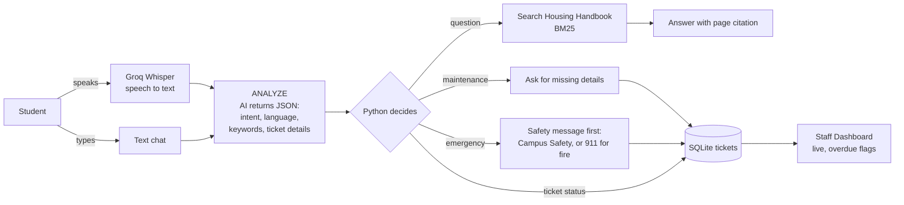

# 🦅 Avila Housing Assistant

A free, 24/7 AI assistant for Avila University students living on campus. Students
**type or talk** to it in plain English (or any language), and it:

- **Answers housing questions** from the official 2026-27 Housing Handbook, citing the page
- **Creates maintenance tickets** by asking only for what's missing (building, room, issue)
- **Puts safety first:** the right number before anything else, as the handbook says: Campus Safety
  (816-985-6079) for smoke, sparks, flooding or alarms; 911 first for a real fire or someone hurt
- **Checks ticket status** ("what's happening with AV-1003?")
- **Tap instead of typing:** every reply has buttons for the next step, so a repair takes four taps

Housing staff get a **live dashboard** that flags overdue repairs using Avila's own
handbook deadlines (urgent: 2 days, regular: 2 weeks).

Built by Avila AI students. Total running cost for the prototype: **$0**.

---

## How it works



**The key idea:** the AI *understands* (messy language, any language), and plain Python
*decides* (search, ask, save). That keeps the agent predictable.

| File | Job |
|---|---|
| `app.py` | Front door: sets up the two pages |
| `views/student_chat.py` | Student screen: voice + text chat, ticket cards |
| `views/staff_dashboard.py` | Staff screen: live tickets, overdue flags, charts |
| `agent.py` | The brain: analyze, then act (5 intents) |
| `knowledge.py` / `ingest.py` | Handbook PDF -> chunks -> keyword search |
| `tickets.py` | SQLite database of tickets + handbook deadlines |
| `voice.py` | Speech in (Groq Whisper) + silent-mic detection. Replies are always written. |
| `llm.py` | The only file that talks to the AI (Groq, with a backup model) |
| `config.py` | Every setting: buildings, phone numbers, models, deadlines |
| `tests/test_flows.py` | Offline checks of the demo flows (double-click `test.bat`) |
| `BUILD_LOG.md` | How we built it, step by step: what, why, what broke |

---

## Run it on Windows

1. Get a free Groq API key at **console.groq.com** (no credit card).
2. Double-click **`setup.bat`** (installs everything + reads the handbook, 1-3 minutes).
3. Open **`.env`** in VS Code, paste your key after `GROQ_API_KEY=`, save.
4. Double-click **`run.bat`**. It checks everything, then opens the app in your browser.

Prefer the terminal? In VS Code's terminal (Command Prompt):
```
python -m venv .venv
.venv\Scripts\activate
pip install -r requirements.txt
python ingest.py
python check_setup.py
streamlit run app.py
```

If the handbook download fails, open the handbook link from `config.py` in your browser,
save the PDF into `data/docs/`, and run `python ingest.py` again.

---

## Demo script (Nov 4)

Open the **Student Assistant** on one screen and the **Staff Dashboard** on the other
(in the dashboard's sidebar click **🔄 Reset demo** -> **Yes, reset the demo** first: 6 sample tickets, numbered from AV-1001).

1. **Question:** "Can my friend stay over this weekend?" -> answer + handbook page.
2. **Voice repair:** tap the mic, say *"The heater in my room isn't working,"* tap stop.
   The agent asks where: tap the hall button, then say or type the room. It creates a ticket.
   **Switch screens: the ticket is already on the dashboard.**
3. **Tap-only repair:** 🔧 Report a repair -> 💧 Leak / plumbing -> Wylie Hall -> type 108.
   No sentences to type, no waiting for the AI.
4. **Another language:** type *"Mi baño tiene una fuga en Wylie 108"*. The answer comes
   back in Spanish; the ticket is saved in English for staff.
5. **Safety:** "There's smoke coming from an outlet in Buchanan 302" -> call Campus Safety first
   (911 if there are flames or someone is hurt), then an EMERGENCY ticket, with call buttons.
   A real fire ("There's a fire in my kitchen") gets 911 first.
6. **Dashboard:** point at the ⚠️ OVERDUE flags: "these are Avila's own deadlines from the handbook."

**Before you present:** run `run.bat` 30 minutes early, test the mic in the room, and keep
a screen recording of the demo as a backup. In the browser, click the mic icon in the address
bar and make sure the laptop's own microphone is selected, not a headset or game controller.

---

## Deploy it online for free (Streamlit Community Cloud)

The repo already includes the handbook index (`data/knowledge.json`) and pinned library versions.

1. Push this repo to GitHub (a **private** repo is fine). `.env` is never uploaded.
2. Go to **share.streamlit.io**, sign in with GitHub, click **Create app**, pick the repo,
   branch `main`, main file `app.py`. Under **Advanced settings** choose **Python 3.12**.
3. In **Advanced settings -> Secrets**, paste: `GROQ_API_KEY = "your-key"` (never in the repo).
4. Deploy. In the app's **Share** settings, make it private and invite teammates by email,
   so strangers can't use up the free AI quota.
5. Free apps sleep after 12 hours without visitors, so open the link before the demo.

The cloud link is https, so the mic works on phones too (allow the microphone when asked).

Note: tickets on the free cloud are stored in a file that resets when the app restarts.
That's fine for a demo; a real Avila rollout would use a hosted database.

---

## Privacy and safety

- Uses **public** Avila information only. No student records, grades or IDs (FERPA-aware by design).
- Demo tickets are fake. Free AI tiers may use what you send to improve their products, so
  never type real personal information during demos.
- The agent only answers from the handbook and says "I'm not sure" instead of inventing policies.
- API keys live in `.env`, which `.gitignore` keeps off GitHub.

---

## Time-travel through the build

Every step is a Git tag. Read `BUILD_LOG.md` alongside:

| Tag | Step |
|---|---|
| `v0.1-setup` | Project skeleton, config, secrets handling |
| `v0.2-knowledge` | Handbook PDF -> searchable chunks with page numbers |
| `v0.3-qa-chat` | Q&A agent + chat screen |
| `v0.4-tickets` | Maintenance tickets, emergencies, status checks |
| `v0.5-dashboard` | Live staff dashboard with overdue flags |
| `v0.6-voice` | Talk to it, hear it answer |
| `v0.7-polish` | Fixes after looking at it in a browser |
| `v1.0-demo` | Windows setup scripts, self-check, README |
| `v1.1-models` | Free gpt-oss models; checks which models the key can use |
| `v1.2-voice-fixes` | Silent-mic warning, repair safety net, written-only replies |
| `v1.3-safety-tiers` | Saved tests; Campus Safety first, 911 for real fires, no false alarms |
| `v1.4-click-first` | Buttons for every step, call buttons, shorter replies, mic fixes and logging |
| `v1.5-printed-pages` | Citations use the page numbers printed in the handbook |
| `v1.6-safe-json` | Retry broken AI answers, rule-based fallback, errors logged not shown |
| `v1.7-fast-failover` | Instant switch to a backup model when one runs out of free tokens |
| `v1.8-demo-ready` | Reset demo button, projector settings (light theme, no developer buttons), tidier table |

```
git checkout v0.3-qa-chat          # see the app as it was at that step
git diff v0.3-qa-chat v0.4-tickets # see exactly what one step added
git checkout main                  # back to the latest
```

## What's next (the agency roadmap)

Admissions assistant · International student assistant · Financial aid FAQ ·
real phone line (call-in voice agent) · Kansas City small-business receptionists.
